<div align="center">

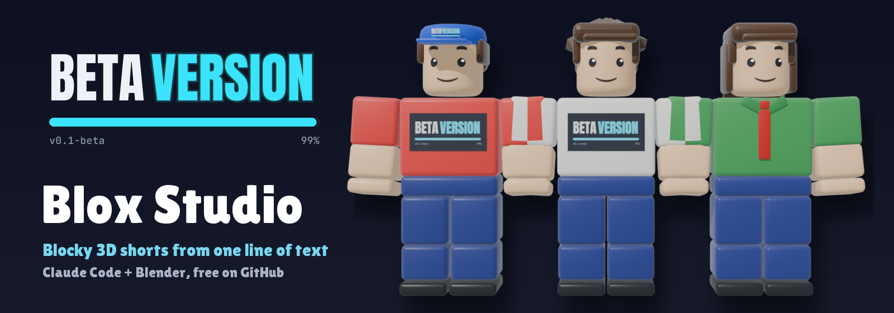

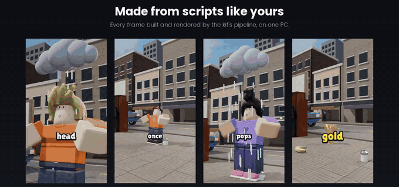

# Beta Version Blox Studio

**Turn an idea, or your own script, into a vertical blocky-3D animated short with Claude Code.**

[](LICENSE.md)
[](skill/SKILL.md)
[](https://www.blender.org/download/)
[](https://www.instagram.com/beta_versionhq/)
[](https://www.youtube.com/@BetaVersion_HQ)
[](https://github.com/ezpeezee/beta-version-blox-studio/stargazers)
[](https://github.com/ezpeezee/beta-version-blox-studio/releases/latest)

### **📣 Like it? Follow [@beta_versionhq on Instagram](https://www.instagram.com/beta_versionhq/) and subscribe on [YouTube @BetaVersion_HQ](https://www.youtube.com/@BetaVersion_HQ) for new tools, updates and behind-the-scenes.**

</div>

---

## 🎬 See it in action

https://github.com/user-attachments/assets/b8a61620-e614-4b59-8725-f3aa0fce79f1

<div align="center"><sub>Every clip above was made with the Blender pipeline this kit comes from.</sub></div>

<p align="center">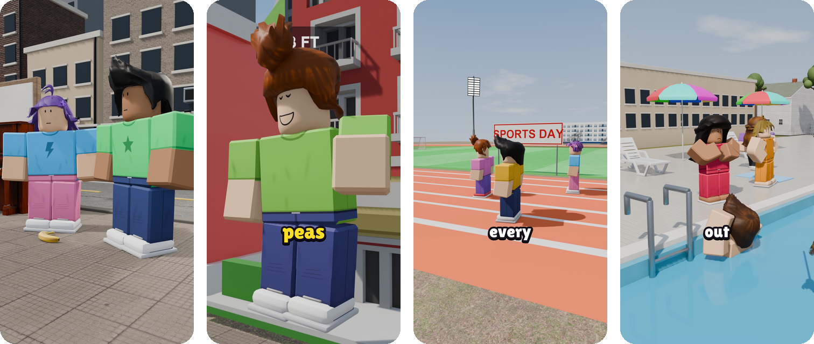</p>

---

## 📺 Watch the full walkthrough

<div align="center">

<a href="https://youtu.be/qy-y6BFmXV0" title="Make Viral Roblox Animations with AI FREE | Free and Unlimited | Claude SKILL">
  
</a>

**▶️ [Make Viral Roblox Animations FREE | Claude SKILL](https://youtu.be/qy-y6BFmXV0)**: setup and a full short, start to finish.

</div>

---

## ✨ What you get

<table>
<tr>
<td width="50%" valign="top">

### 📝 Script help
Give it one line and it writes a short script, or paste yours and it uses it word for word.

</td>
<td width="50%" valign="top">

### 🧱 Blocky 3D characters
Built entirely in code: walk, talk, point, cheer, panic, with 12 faces and lip-sync. No downloads, no rigs to buy.

</td>
</tr>
<tr>
<td valign="top">

### 🏙️ Worlds from your story
Every short gets its own places, built from its script: a street, kitchen, gym, music shop and town pool, ten presets (bedroom, classroom, store, park and more), or any place Claude writes from 50+ code-built props. Free CC0 textures, sunny, storm and night lighting. New places land in the kit regularly.

</td>
<td valign="top">

### 🗣️ Voice and captions
Free Kokoro text-to-speech reads your script, or bring your own recording. Every caption and mouth movement lands on its word.

</td>
</tr>
<tr>
<td valign="top">

### 🎥 Camera and effects
16 camera framings, pushes and crash-ins, rain clouds over heads, lightning, smoke.

</td>
<td valign="top">

### 📱 Ready to post
A 9:16 video at 30 fps, with sound effects and a music bed made in code.

</td>
</tr>
</table>

---

## 💡 Ideas to try

Paste any of these after `/beta-version-blox-studio` in Claude Code. Every still is from a real short made from an idea like the one under it.

<table>
<tr><td align="center" valign="top" width="20%">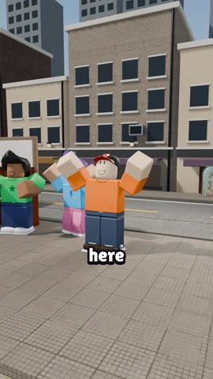<br><sub><b>1.</b> a town where you shrink every time you say "I can't"</sub></td><td align="center" valign="top" width="20%">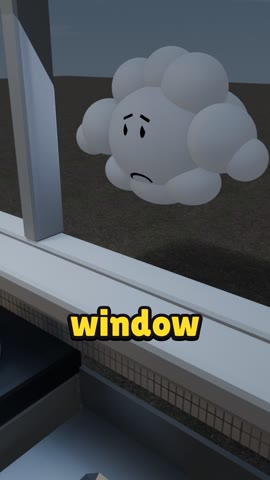<br><sub><b>2.</b> a town where complaining puts a rain cloud over your head</sub></td><td align="center" valign="top" width="20%">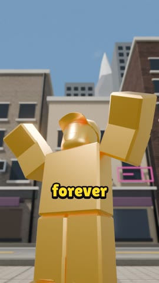<br><sub><b>3.</b> a town where whoever laughs last turns into a tiny gold trophy</sub></td><td align="center" valign="top" width="20%">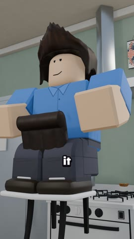<br><sub><b>4.</b> a town where anything you drop stops in mid-air forever</sub></td><td align="center" valign="top" width="20%">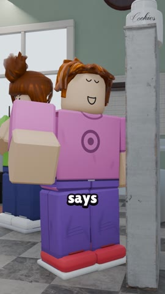<br><sub><b>5.</b> a town where every lie lifts you one foot off the ground</sub></td></tr>
<tr><td align="center" valign="top" width="20%">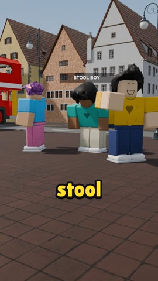<br><sub><b>6.</b> a town where anyone standing at the noon bell turns to stone</sub></td><td align="center" valign="top" width="20%">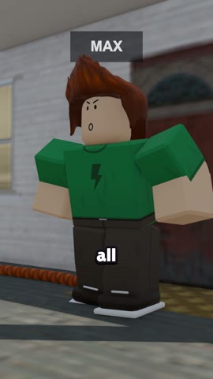<br><sub><b>7.</b> a town where every shout makes your braid a foot longer</sub></td><td align="center" valign="top" width="20%">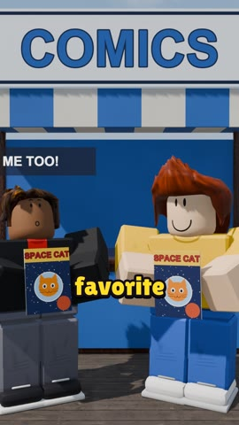<br><sub><b>8.</b> a town where saying the same word at once swaps your clothes</sub></td><td align="center" valign="top" width="20%">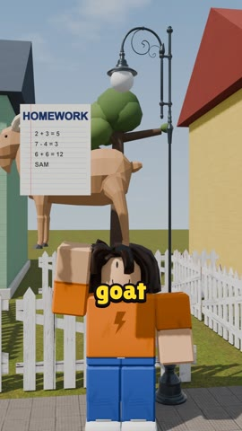<br><sub><b>9.</b> a town where anything you point at sticks to your finger till sunset</sub></td><td align="center" valign="top" width="20%">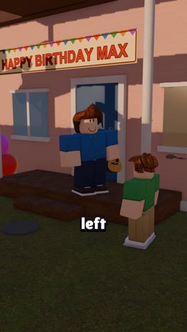<br><sub><b>10.</b> a town where every job you put off floats behind you</sub></td></tr>
</table>

<details>
<summary><b>Copy-paste versions</b></summary>

```text
/beta-version-blox-studio a short about a town where you shrink every time you say "I can't"
/beta-version-blox-studio a short about a town where complaining puts a rain cloud over your head
/beta-version-blox-studio a short about a town where whoever laughs last turns into a tiny gold trophy
/beta-version-blox-studio a short about a town where anything you drop stops in mid-air forever
/beta-version-blox-studio a short about a town where every lie lifts you one foot off the ground
/beta-version-blox-studio a short about a town where anyone standing at the noon bell turns to stone
/beta-version-blox-studio a short about a town where every shout makes your braid a foot longer
/beta-version-blox-studio a short about a town where saying the same word at once swaps your clothes
/beta-version-blox-studio a short about a town where anything you point at sticks to your finger till sunset
/beta-version-blox-studio a short about a town where every job you put off floats behind you
```

</details>

---

## 🚀 Quick start

**The easy way:** install [Claude Code](https://claude.com/claude-code), then paste this into it:

```text
Set up github.com/ezpeezee/beta-version-blox-studio on my PC, and run its test.
```

It clones the repo, follows [SETUP.md](SETUP.md), checks your tools (and gives you the install command for anything missing),
makes the Python environment and renders the 10-second test clip.

<details>
<summary><b>Prefer to set it up by hand? Click here.</b></summary>

```text
1. Install Blender 5.2, Python 3.11+, ffmpeg and Claude Code
2. pip install -r kit/requirements.txt -r kit/requirements-voice.txt
3. Copy skill/ to ~/.claude/skills/beta-version-blox-studio/
4. python kit/run.py kit/projects/test10 all
5. Open Claude Code in the repo and type:

   /beta-version-blox-studio a short video about a kid who can't stop sneezing
```

</details>

## 🛠️ How it works

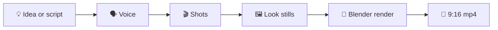

<details>
<summary><b>What happens at each step</b></summary>

| Step | What happens |
|---|---|
| **1. Script** | It writes one from your idea, or uses yours. |
| **2. Voice** | Kokoro TTS reads each line (or your recording is used), and shots stretch to fit the voice. |
| **3. Shots** | Claude writes `shots.py`: the cast and one line per shot ([API](kit/API.md)). |
| **4. Look** | One still per shot comes first, and a check makes sure no two characters overlap. |
| **5. Render** | Blender renders frames on several processes at once. |
| **6. Finish** | Captions, music and sound effects are added, and the mp4 is written. |

```text
python kit/run.py kit/projects/<name>               # shots, compile, stills
python kit/run.py kit/projects/<name> render post   # full render and the mp4
```

</details>

<details>
<summary><b>💻 Requirements</b></summary>

| | |
|---|---|
| **OS** | Windows 10/11 (Linux and macOS work with the Blender path set) |
| **Software** | Blender 5.2, Python 3.11+, ffmpeg, Claude Code |
| **Hardware** | An NVIDIA GPU is best; a CPU also works, more slowly. About 4 GB RAM per render process |

</details>

---

## 🙌 Made something? Share it

Post your short in **[Show and tell](https://github.com/ezpeezee/beta-version-blox-studio/discussions/categories/show-and-tell)**, or use the **[Share your short](https://github.com/ezpeezee/beta-version-blox-studio/issues/new?template=share-your-short.yml)** form. The best ones get featured here.

Add this badge to your video description or your own repo:

[](https://github.com/ezpeezee/beta-version-blox-studio)

```markdown
[](https://github.com/ezpeezee/beta-version-blox-studio)
```

---

## 🧰 Also from Beta Version

<table>
<tr>
<td width="140"><a href="https://github.com/ezpeezee/beta-version-toon-studio"></a></td>
<td><b><a href="https://github.com/ezpeezee/beta-version-toon-studio">Beta Version Toon Studio</a></b><br>The same idea-to-short kit with flat, hand-drawn-style cartoon characters in painted 3D worlds.</td>
</tr>
</table>

---

<div align="center">

Made by **Beta Version** · [Instagram](https://www.instagram.com/beta_versionhq/) · [YouTube](https://www.youtube.com/@BetaVersion_HQ)

Stuck, or something broke? DM me on Instagram.

<sub>Not affiliated with Roblox Corporation. The characters are original, code-built blocky figures.</sub>

</div>
